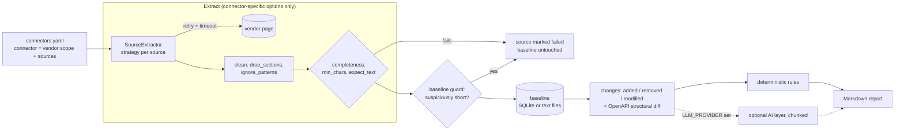

# Connector Docs Watchdog

A command-line tool that watches the public API documentation and changelogs of the platforms your
integrations depend on. It compares what it fetches with the last stored version and writes a Markdown
report of deprecations, removals and potentially breaking changes, each one with the vendor text that
triggered it.

It works without an API key. An AI provider can be added as an optional layer, but nothing depends on it.
It is a CLI only: YAML configuration in, Markdown reports out.

This is a standalone demonstration project, not a monitoring service I run or maintain. It shows the
architecture, the deterministic detection and the connector design. The three configured connectors are
examples of that design, not a promise of ongoing vendor coverage. To use it for your own monitoring you
would configure your own sources, environment and scheduling.

**Overview:** [Why it exists](#why-it-exists) · [Connectors](#connectors) · [What it detects](#what-it-detects) · [How it works](#how-it-works) · [Example reports](#example-reports) · [Deterministic vs AI](#deterministic-monitoring-and-the-optional-ai-layer)
**Getting started:** [Requirements](#requirements) · [Installation](#installation) · [Running the CLI](#running-the-cli) · [Tests](#running-the-tests) · [Configuration](#configuration-and-environment-variables) · [Reading a report](#understanding-a-report)
**Reference:** [Architecture](#architecture-and-data-flow) · [AI layer](#optional-ai-classification-layer) · [Add a connector](#adding-a-new-connector) · [Pinterest example](#worked-example-a-hypothetical-pinterest-ads-connector) · [Troubleshooting](#extraction-troubleshooting) · [OpenAPI](#openapi-support) · [Meta](#meta-specific-extraction-decisions) · [Weekly automation](#weekly-automation-with-github-actions) · [Baselines](#baseline-backup-and-migration) · [Validation status](#connector-validation-status) · [Limitations](#known-limitations) · [License](#license-and-third-party-content)

---

# Overview

## Why it exists

Integrations that depend on third-party platforms are exposed to changes they do not control. A vendor can
change how an endpoint behaves, deprecate a feature, remove a resource or introduce a breaking change. The
announcement may be incomplete, may sit in a changelog nobody is watching, or may simply be missed in a manual
review.

When that happens, the integration code is not adapted in time. The visible result is a broken data source, a
failed integration or a production incident, and the customer is the one who notices.

The idea behind this tool is simple. Watch the relevant vendor documentation and changelogs on a schedule,
pick out what looks relevant, and give engineers an evidence-based report they can review. That buys time to
assess the risk, change the integration code and react before customers are affected.

I settled on a weekly cycle. Vendors do not rewrite their documentation every day, so continuous monitoring
is not worth the operational effort, and a weekly review is enough to work as an early warning.

The goal is not to catch every change. It is to reduce the chance of a missed one and to give the team more
time to react when something does show up.

## Connectors

This project is a standalone recreation of a documentation-monitoring tool originally developed for an
internal use case at a previous company. In that environment, platforms were integrated as *connectors*, and
the term carries over here.

For this version I configured three of the main advertising-platform connectors from that environment:

| Connector | id | Sources |
|---|---|---|
| Meta Ads | `meta-ads` | Marketing API changelog index, versioned changes (v26.0, v25.0), out-of-cycle changes, developer blog feed |
| Google Ads | `google-ads` | Google Ads API release notes, sunset dates |
| LinkedIn Marketing | `linkedin-marketing` | Marketing API "Recent changes" |

These are the three connectors currently configured, and the only ones with validated sources. The
architecture is modular: another connector is added by describing its documentation sources in
`connectors.yaml`, provided those sources can be fetched, extracted and validated with the mechanisms
described in [Adding a new connector](#adding-a-new-connector). Other platforms appear in this README only as
a hypothetical example. The `connectors.yaml` file also holds five further entries (Google Analytics 4,
TikTok Ads, HubSpot, Salesforce, Shopify), disabled because their URLs have not been verified.

## What it detects

On the pages it watches, it detects text that was added, removed or rewritten, and classifies each change
with fixed rules:

- **deprecation**: deprecation, sunset, end-of-life wording, with the deadline when the text states one
- **removal**: something was removed or is no longer supported or available; also removed documentation text
- **breaking**: "breaking changes", "action required" and similar wording
- **new**, **informational**: everything else that changed, so nothing is dropped silently

For OpenAPI specifications it also compares structure: operations, parameters, required flags, types, request
bodies, responses, schema fields and deprecation flags (see [OpenAPI support](#openapi-support); none of the
configured connectors uses an OpenAPI source yet).

It only sees what a vendor publishes on the configured pages, and it works from wording, not from an
understanding of the change. See [Known limitations](#known-limitations).

## How it works

1. Fetch each source of each connector (with timeouts and a bounded number of retries) and extract its text.
2. Clean the text and check it is complete (minimum length, expected end-of-page text, not suspiciously
   shorter than the stored baseline).
3. Compare it with the stored baseline: what was added, removed or modified.
4. Classify the changes with the deterministic rules. If an AI provider is configured, it adds its own
   findings on top.
5. Write a Markdown report that records what was fetched, what happened to each source, and the findings.
6. Move the baseline forward only for sources where every step succeeded.

A failed, incomplete or suspicious fetch never replaces a good baseline, and the report says so. The
[architecture section](#architecture-and-data-flow) has the diagram and module map.

## Example reports

- [`docs/examples/simulated-detection-2026-11-03.md`](docs/examples/simulated-detection-2026-11-03.md):
  what findings look like. It runs offline over the synthetic Meta Ads and LinkedIn Marketing fixtures, with
  the stored baseline made from a copy that lacks the deprecation notice, so the tool rediscovers it. The text
  and dates are invented, and the file opens with a note saying so. It is **not** a vendor announcement.
- [`docs/examples/live-report-2026-11-03.md`](docs/examples/live-report-2026-11-03.md): an unedited live run
  against the pre-existing baseline. The six sources that already had a baseline showed no changes, and the
  two new Meta version pages got their first baselines.
- [`reports/demo-report.md`](reports/demo-report.md): output of `docs-watchdog --demo`, built from bundled
  **synthetic** sample data (no vendor text). It is stamped as a demonstration and says it is not a monitoring
  result.

Every report states its data origin (`LIVE` or `DEMO`) at the top.

## Deterministic monitoring and the optional AI layer

| | Deterministic (default) | Optional AI layer |
|---|---|---|
| Fetching, extraction, comparison, baselines | yes | same code path |
| Classification | fixed rules | adds model-written findings |
| API key | not needed | `LLM_PROVIDER` and `LLM_API_KEY` |
| Exercised against | live runs on real vendor pages | mocked providers only |

The AI layer adds findings next to the deterministic ones; it never replaces or removes them. If it fails,
the deterministic findings are still in the report. It has not been run against a real provider (see
[Optional AI classification layer](#optional-ai-classification-layer)).

---

# Getting started

## Requirements

Python 3.11 or newer. The test suite passes on Python 3.14 (my development interpreter) and on Python 3.12
(the one the weekly workflow uses), the latter in a clean environment built from `constraints.txt`.
No credentials are needed for anything in this section.

## Installation

```bash
# from the root of your clone of this repository
python -m venv .venv && source .venv/bin/activate
pip install -e '.[dev]'
```

Optional extras:

- `pip install -e '.[browser]' && playwright install chromium`: only for the Playwright fallback of one Meta
  source.
- `pip install -e '.[anthropic]'`: the Anthropic SDK for the optional AI layer. The `openai` provider needs
  nothing extra.

This installs the `docs-watchdog` command and the `docs_watchdog` package. If the command is not on your
PATH, `python -m docs_watchdog.cli` takes the same arguments.

## Running the CLI

```bash
docs-watchdog --validate-only                  # check connectors.yaml and exit
docs-watchdog --demo                           # offline demo on bundled sample data; no network

# live monitoring: deterministic, no API key
docs-watchdog                                  # every enabled connector
docs-watchdog --only meta-ads                  # one connector, by id or name
docs-watchdog --only google-ads
docs-watchdog --only linkedin-marketing
docs-watchdog --only meta-ads --dry-run        # fetch and compare, write nothing at all
docs-watchdog --state-dir /tmp/wd --out /tmp/wd/reports   # try things without touching ./data
docs-watchdog --no-llm                         # force deterministic mode even if an LLM is configured
docs-watchdog -v                               # debug logging
```

`--demo` reads files bundled in the package and makes no network request. Every other command fetches the
real URLs. The first live run stores a baseline for each source and the report says so; later runs compare
against it. Reports go to `reports/` as `<UTC timestamp>.md` (earlier reports are never overwritten) plus
`latest.md`. The exit code is 0 for a complete run, 1 if anything failed or was incomplete, and 2 for a
configuration error.

## Running the tests

```bash
pytest
```

The tests run offline and need no credentials. Page fixtures are in `tests/fixtures/` and are of two kinds,
described in `tests/fixtures/MANIFEST.json`: short **excerpts** of real Google pages (Google states a CC BY 4.0
license for its documentation), and **synthetic** pages for Meta and LinkedIn Marketing, with invented text on
the structure of the real pages. There are also synthetic OpenAPI specs and mocked HTTP and LLM providers.
The workflow is checked statically; it is never executed by the tests. No test touches the network.

## Configuration and environment variables

Connectors are defined in `connectors.yaml` (`--config` selects another file).

| Connector field | Meaning |
|---|---|
| `name` | Human-readable name; also the key baselines are stored under |
| `id` | Stable identifier for `--only` (defaults to a slug of `name`) |
| `vendor`, `scope` | Who it is and what it covers |
| `priority`, `enabled` | Run order (lower first); disabled connectors are skipped |
| `sources` | The list below |

| Source field | Meaning |
|---|---|
| `id`, `url` | Unique within the connector; HTTPS only; `{year}` expands to the current year |
| `type` | `http` (alias `html`), `markdown`, `rss`, `openapi`, `playwright`, or a registered custom strategy |
| `verified` | `true` once someone has checked the extracted text; unverified sources are listed in every report |
| `min_chars` | Shorter extractions count as an incomplete source (default 200) |
| `expect_text` | Strings that must appear in the extracted text; missing means incomplete source |
| `drop_sections` | Headings whose whole section is removed (volatile text such as auto-generated summaries) |
| `ignore_patterns` | Regexes; lines matching them entirely are removed |
| `min_length_ratio` | Baseline guard, default 0.5; `0` disables it |
| `selector`, `fallback` | CSS selector for `playwright`; another source definition tried when the primary fails |

Environment variables are read from the process environment only (the CLI does not load `.env`), and all of
them are optional:

| Variable | Meaning |
|---|---|
| `LLM_PROVIDER` | `anthropic`, `openai` (any OpenAI-compatible endpoint) or `demo`. Unset means deterministic mode. |
| `LLM_API_KEY` | Credential for the provider |
| `LLM_MODEL` | Model name (defaults: `claude-sonnet-5-5`, `gpt-4o-mini`) |
| `LLM_BASE_URL` | Endpoint override (Azure OpenAI, OpenRouter, Ollama, vLLM, an internal gateway) |

A provider that is set but invalid (for example without `LLM_API_KEY`) is an error with exit code 2, not a
silent fallback. Baselines are kept in SQLite at `--db` (default `data/snapshots.db`) or, with `--state-dir`,
as plain-text files. `.env.example` documents the variables; never commit keys or tokens.

## Understanding a report

A report starts with the run status and the data origin, followed by a **Source provenance** table: for each
source, its outcome, the URL actually fetched (and whether it was redirected), HTTP status, fetch time in UTC,
extracted size, and a fingerprint (the first 12 hex digits of the SHA-256 of the extracted text, so runs can
be compared without storing page content). Findings follow, grouped into potentially breaking changes,
removals, deprecations, parameter and schema changes, new functionality, and informational changes.

Each finding has a description, the quoted evidence, the previous and new state when there is one, the
source URL, a deadline if the text states one, and an impact statement. The impact says "Not determined"
whenever the evidence does not support one. A deadline is shown relative to the report date, so one that has
already passed is marked **ALREADY PASSED** rather than looking like a future date.

Severity and confidence come from fixed keyword rules (a stated date raises severity; confidence is a
constant per rule). They say how explicit the vendor wording is, not how much a particular integration is
affected. A quoted passage shows the wording exists in the retrieved text; it does not prove the
classification is right. Treat findings as leads to verify.

Run status is `COMPLETE`, `COMPLETE, with N warning(s)` or `INCOMPLETE`. An incomplete run exits with code 1,
and a missing finding in an incomplete run does not mean nothing changed. What happened to each source:

| Source outcome | Meaning | Baseline |
|---|---|---|
| baseline created | First successful fetch; nothing to compare yet | stored |
| no changes | Fetched and identical after normalization | kept |
| changed | Differences found and classified | advanced |
| **FETCH FAILED** | Network error, HTTP error or robots.txt refusal after bounded retries | kept |
| **EXTRACTION FAILED** | Fetched, but the structure was unexpected (for example an HTML error page served with HTTP 200) | kept |
| **INCOMPLETE SOURCE** | Too short, an `expect_text` marker missing, or shrunk below `min_length_ratio` of the baseline | kept |
| **AI STEP FAILED** | The optional AI layer failed; deterministic findings are still reported | kept, retried next run |

---

# Technical reference

## Architecture and data flow



The engine owns everything that is not vendor-specific: fetching and orchestration, normalization, comparison,
classification, evidence validation, baselines, run status and provenance, and the report. A connector
contributes configuration (vendor, scope, sources and their extraction settings) and, only when the standard
strategies are not enough, one small extraction function.

A baseline advances only when extraction, comparison and every enabled processing step succeeded for that
source. That is the rule behind every "kept" in the outcome table above.

| Module (`src/docs_watchdog/`) | Responsibility |
|---|---|
| `config` | Loads and validates `connectors.yaml` |
| `fetch`, `browser` | HTTP with robots.txt, timeouts, bounded retries and a provenance record; optional Playwright |
| `extract`, `extractors` | Strategies, the strategy registry, per-source cleanup and completeness checks |
| `openapi` | Canonical OpenAPI rendering and structural comparison |
| `store` | Baselines: SQLite (`Store`) or plain-text files (`FileStore`) |
| `diff` | Added / removed / modified changes, rendering, lossless chunking |
| `rules` | Deterministic classification into findings |
| `classify`, `llm` | Optional AI layer, its output validation, and provider implementations |
| `pipeline`, `report`, `cli` | Orchestration, per-source status, report, command line |
| `connectors/` | Optional connector-specific Python; currently only a labelled example |
| `demo`, `demo_data/` | The offline demonstration |

## Optional AI classification layer

With `LLM_PROVIDER` set, the same detected changes (added, removed, modified, structural) are also sent to the
model in chunks of at most 12,000 characters. Nothing is truncated. A provider implements one method,
`complete(system, user) -> str`, in `llm.py`; validation is shared by all providers.

The AI layer is supplementary. The deterministic findings are always produced first, and the model's findings
are added next to them, marked "AI interpretation" in the report. They never replace or remove a deterministic
finding. If the provider is unavailable or the AI step fails, the deterministic findings stay in the report.

- The response must be valid JSON with a known change type and severity. `evidence` must appear verbatim in
  the detected change, otherwise it is flagged and confidence is capped at 50%.
- `confirmed` must be a real boolean and only `true` confirms. A `deadline` is kept only if that full date is
  written in the verified evidence. An unconfirmed `high` is downgraded to `medium`.
- Findings that fail validation are listed under *Warnings* instead of disappearing.
- A truncated response is retried on smaller pieces. If that still fails, the source is reported as failed
  (the run is `INCOMPLETE`), the deterministic findings stay in the report, and the baseline does not advance,
  so the AI step is retried on the same change next run.

**Validation status.** This layer has not been validated against a live LLM provider. The Anthropic and
OpenAI-compatible providers, the output validation and the failure paths are tested with mocked providers and
mocked HTTP only; no real model response has gone through it. That is separate from my experience with the
original internal tool, where I used company-provided LLM resources to help troubleshoot API connectivity
issues and investigate documentation gaps. That was troubleshooting and investigation work, not a test of this
classification layer, so it is not evidence that this implementation works. The original internal tool is not
part of this repository.

## Adding a new connector

A connector is a vendor scope plus its official sources. The engine does the rest, and most connectors need
no Python.

**1. Identify the official sources.** Look for a changelog, release-notes, sunset or deprecation page on the
vendor's own documentation site. See what a plain fetch returns:
`curl -sL -A "connector-docs-watchdog/0.1" <url> | head`. If the content is in the HTML, use `http`. If the
vendor offers a Markdown, RSS/Atom or OpenAPI version of it, prefer that (`markdown`, `rss`, `openapi`). If the
page is built in the browser, use `playwright` (needs the browser extra and a CSS `selector`), ideally as the
`fallback` of a plain-HTTP source.

**2. Add the connector to `connectors.yaml`.** A template with comments is in
[`examples/connector.example.yaml`](examples/connector.example.yaml), clearly marked as an example:

```yaml
  - name: Example Vendor Ads        # also the key baselines are stored under
    id: example-vendor-ads          # stable id for --only
    vendor: Example Vendor
    scope: Example Ads API
    priority: 3
    enabled: true
    sources:
      - id: changelog
        type: http
        verified: false             # set true after step 4
        url: "https://vendor.example/docs/changelog"
        min_chars: 200
        expect_text: ["Archived"]   # text that must appear
        drop_sections: ["Page Summary"]
        ignore_patterns: ["Cookie notice.*"]
```

**3. Set the completeness checks and extraction settings.** These are what make a bad fetch visible:

- `expect_text`: use a string from the *end* of the page. A truncated fetch will not contain it, and the
  source is reported as an incomplete source instead of becoming a baseline.
- `min_chars`: the smallest plausible extraction for this page.
- `drop_sections` and `ignore_patterns`: remove text that changes without the vendor changing anything, such
  as auto-generated summaries or UI boilerplate.
- `selector` and `fallback`: only for browser-rendered pages.

**4. Validate the extracted content.**

```bash
docs-watchdog --validate-only
docs-watchdog --only example-vendor-ads --dry-run -v            # fetch and extract, write nothing
docs-watchdog --only example-vendor-ads --state-dir /tmp/wd --out /tmp/wd/reports
less /tmp/wd/snapshots/example-vendor-ads/changelog.txt         # the text that will be compared
```

Read the stored text: it should contain the changelog entries and nothing volatile. Then run the same command
a minute later. The second run must report "no changes"; if it does not, something volatile is still in the
text. Once it is stable, set `verified: true`.

**5. Add a fixture, after checking the vendor's terms.** Fetch the page once to a local file and look at it, but
do not commit a full copy. First find out whether the vendor allows redistribution of its documentation
(a license statement on the page, or its terms of use):

- If it grants a license such as CC BY 4.0, commit a short **excerpt** to `tests/fixtures/excerpts/`: the
  page structure the extractor needs plus only the sections your assertions depend on. Keep the attribution,
  source URL, capture date, the SHA-256 of the original response and a list of the changes in a comment at
  the top of the file.
- If it does not, or you cannot tell, write a **synthetic** page in `tests/fixtures/synthetic/`: invented text
  on the same HTML structure. Label it `SYNTHETIC` and do not copy the vendor's wording.

```python
# one-off script to look at a page locally; do not commit its output, tokens or cookies
import hashlib
from docs_watchdog.fetch import HttpFetcher
h = HttpFetcher(); body = h.get("https://vendor.example/docs/changelog")
open("/tmp/changelog.html", "w").write(body)
print(h.last.status, h.last.fetched_at, hashlib.sha256(body.encode()).hexdigest())
```

Add an entry to `tests/fixtures/MANIFEST.json`: `origin` (`excerpt` or `synthetic`), connector id, source id,
`type`, per-fixture `min_chars` and `min_headings`, and either the provenance (URL, HTTP status, capture date,
`original_sha256`, `license`, `kept_sections`) or `modeled_on` and `structure`. Record what you found about the
vendor's terms in `THIRD_PARTY_NOTICES.md`.

**6. Add tests.** `tests/test_fixtures.py` iterates the manifest, so a new entry is automatically checked for
provenance fields, small size, extraction above its minimums, the `expect_text` markers, rejection of
truncated pages and stability between two extractions. Add one assertion that is specific to the vendor, for
example that a deprecation notice is found with its deadline after you remove it from a copy of the baseline,
following `test_synthetic_meta_deprecation_is_found_with_its_deadline`.

**7. Write a custom strategy only if configuration is not enough.** That is the case when the standard
strategies cannot turn the page into usable text, for example because the useful content is embedded in a
script tag. A strategy is a deterministic function from the raw HTTP body to normalized text. Put it in
`src/docs_watchdog/connectors/<vendor>.py` and import that module in
`src/docs_watchdog/connectors/__init__.py`:

```python
from ..extract import normalize
from ..extractors import register_strategy

def vendor_changelog(raw: str) -> str:
    """Parse the vendor's page into plain text, one entry per line."""
    ...  # regex or an HTML parser; return normalize(text)

register_strategy("vendor-changelog", vendor_changelog)   # then use: type: vendor-changelog
```

`src/docs_watchdog/connectors/example.py` is a working example (not one of the configured connectors), and
`tests/test_connector_contract.py` runs the template through the whole pipeline. The three configured
connectors use no custom strategy; a test enforces that. At no point do you touch the diff engine, the rules,
the store or the report.

## Worked example: a hypothetical Pinterest Ads connector

**This connector does not exist in the project.** It is an illustration, with a fictional host. Suppose
Pinterest's changelog is server-rendered HTML, ends with a section titled "Previous years", and has an
auto-generated "Overview" box at the top.

```yaml
  - name: Pinterest Ads
    id: pinterest-ads
    vendor: Pinterest
    scope: Pinterest Ads API
    priority: 2
    enabled: true
    sources:
      - id: api-changelog
        type: http
        verified: false
        url: "https://docs.pinterest.example/ads/changelog"
        drop_sections: ["Overview"]          # volatile auto-generated box
        expect_text: ["Previous years"]      # end-of-page marker
```

1. `docs-watchdog --validate-only`, then `docs-watchdog --only pinterest-ads --dry-run -v`.
2. Run it into a scratch directory (`--state-dir /tmp/wd --out /tmp/wd/reports`) and read
   `/tmp/wd/snapshots/pinterest-ads/api-changelog.txt`.
3. Run it again; if the second run is not "no changes", remove what changed with `drop_sections` or
   `ignore_patterns`. Then set `verified: true`.
4. Check the site's terms, add an excerpt or synthetic fixture and its manifest entry (step 5 above). The
   existing fixture tests cover it from there.
5. If the site publishes an OpenAPI file, add it as `type: openapi` and get structural comparison. If the page
   needs real parsing, register a strategy and use its name as `type`.

The monitoring engine is not modified at any step.

## Extraction troubleshooting

| Symptom | Likely cause and fix |
|---|---|
| `INCOMPLETE SOURCE: extraction returned N chars` | Page rendered in the browser (try `markdown`/`rss`, or `playwright` with a `selector`), or `min_chars` set too high |
| `expected text ... not found` | Truncated fetch, a redirect to a login or consent page, or the end-of-page text changed. Fetch the URL by hand and look |
| `EXTRACTION FAILED: unexpected structure` | The server answered HTTP 200 with an HTML shell instead of the document (a soft 404) |
| `FETCH FAILED: HTTP 403` or `429` | The site refuses automated access or is rate-limiting. Do not work around it; lower the frequency or find another official source |
| `robots.txt disallows` | The tool honours robots.txt. Use a different source |
| The second run reports changes on an unchanged page | Volatile text in the extraction: add `drop_sections` or `ignore_patterns` |
| `extraction shrank ... probably a partial page` | The fetch was partial, or the page really shrank (then set `min_length_ratio: 0` for one run) |

## OpenAPI support

OpenAPI is a standard, vendor-neutral format for describing an HTTP API in a JSON or YAML document; it is a
specification file, not a service. `type: openapi` stores a canonical, line-per-fact rendering of the spec
(operations, parameters, required flags, types, request bodies, responses, schema fields, deprecation) and
compares it structurally. A removed operation is a `removal`. A new required parameter, or a change to a required flag or a type, is `breaking`.
Optional additions are `schema` changes and are not treated as breaking. Changes to the version, a summary or
an `operationId` are `informational`. OpenAPI 3.x and Swagger 2 are read; only local `$ref`s are resolved.

None of the configured connectors uses an OpenAPI source, so this is tested on synthetic specifications only.

## Meta-specific extraction decisions

Meta's changelog page is rendered in the browser, and Meta publishes no feed or OpenAPI description for
Marketing API changes. Each documentation page does have a raw Markdown version (the "View as Markdown"
link), served over plain HTTP. That is more stable than parsing a rendered page, so the `markdown` strategy
is the primary source and Playwright stays as a fallback for the changelog index. It is a documented site
feature rather than a versioned API, which is why the fallback is kept.

- Unknown `.md` URLs answer HTTP 200 with an HTML shell. The `markdown` strategy rejects that.
- Meta serves an empty page to user agents containing a parenthetical comment, so the user agent is kept
  short.
- The changelog page is only an index. The versioned changes live on one page per API version, so
  `connectors.yaml` lists the v26.0 and v25.0 pages explicitly. When a new version appears in the index, its
  page has to be added by hand.

## Weekly automation with GitHub Actions

`.github/workflows/watch.yml` runs the deterministic monitor every Monday at 06:17 UTC (GitHub cron is always
UTC) and on demand, with no secrets. It runs the tests, then `docs-watchdog --no-llm --state-dir ...`, and
commits snapshots and reports to a separate `watchdog-data` branch instead of relying on the Actions cache.
Runs are serialised, permissions are limited to what the push needs, and the job fails when tests fail or a
source fails. Activation steps, how to check the schedule is still enabled, and how to recover state are in
[`docs/weekly-automation.md`](docs/weekly-automation.md).

This is optional example automation, not a service. I have not verified it on GitHub: its install and test
steps were run locally on Python 3.12, and its persistence script was exercised against a local bare
repository. If you fork the repository and do not want weekly runs, disable the workflow in the Actions tab.

## Baseline backup and migration

Baselines are the one piece of state that cannot be recreated, because they hold the history you compare
against. The tool never deletes one; it only advances it after a fully successful run.

If you rename a connector, or change its `drop_sections` or `ignore_patterns`, old baselines stop matching
what a fresh extraction produces, and the next run would report the difference as vendor changes. Do not
delete the database. Copy it, then migrate the copy:

```bash
cp -p data/snapshots.db data/backups/snapshots-$(date +%Y%m%d)-pre-migration.db
python scripts/migrate_baseline.py data/snapshots.db data/snapshots.migrated.db \
    --rename "LinkedIn Ads=LinkedIn Marketing"      # OLD=NEW, repeatable
```

The script never modifies its source, refuses to overwrite its destination, re-applies the current cleanup
rules to every stored snapshot (history is kept) and prints old and new fingerprints. When you are satisfied,
move the migrated file into place. To preview a change safely, run against a copy:
`docs-watchdog --db <copy> --out <scratch>`.

## Connector validation status

State as of 2026-11-03:

| Connector | Configured | Live fetch | Extraction validated | Monitoring tested |
|---|---|---|---|---|
| Meta Ads | yes | 5 sources, HTTP 200 | synthetic fixtures modelled on the real structure, plus live completeness checks | live run vs. earlier baseline; controlled simulation (synthetic) |
| Google Ads | yes | 2 sources, HTTP 200 | excerpts of the real pages | same |
| LinkedIn Marketing | yes | 1 source, HTTP 200 (redirects to a versioned URL) | synthetic fixture modelled on the real structure, plus live completeness checks | same |

- **Live fetch:** the real URL returned HTTP 200 and passed the completeness checks.
- **Extraction validated:** the fixtures in `tests/fixtures/` extract offline above their per-fixture minimums,
  with the end-of-page markers present, at least 95% of the HTML pages' h2/h3 headings kept (headings removed
  on purpose, such as Google's auto-generated "Page Summary", do not count), and truncated pages rejected.
  Only the Google fixtures are real page text. For Meta and LinkedIn the fixtures are synthetic, so they test
  the extraction logic against the real page *structure*, not against today's real markup. That is covered
  only by running the CLI live, where the `expect_text` end-of-page markers and the length checks fail the
  source if a real page changes shape.
- **Monitoring tested:** a live run against an earlier stored baseline reported no changes. A controlled
  simulation over synthetic pages, with one section removed from the baseline, made the engine rediscover
  the deprecation notices. That shows the detection logic works. It is not a vendor announcement.

Not yet done: observing a real vendor change over time. Repeated weekly monitoring has not happened.

## Known limitations

- Classification is rule-based and has not been measured for precision or recall. Wording the rules do not
  know is missed, and keyword hits can be false positives. One turned up during development: "Minor versions
  don't contain breaking changes" was read as a breaking change. It is fixed with a negation guard and a
  regression test; others may remain.
- One vendor section can produce several related findings (a "Breaking changes" heading plus the removals
  under it, for example).
- Only the configured pages are watched. Changes announced elsewhere (e-mail, blog posts, console banners)
  or not documented are not seen.
- A change in the real markup of the Meta or LinkedIn pages would not be caught by the offline tests, because
  their fixtures are synthetic. Live runs are the check for that.
- The AI layer has never run against a real provider, and OpenAPI comparison has only been tested on
  synthetic specs.
- The scheduled workflow is unproven on GitHub, and installing Chromium (needed only for one Meta fallback)
  was not tested.
- Sources run one after another, snapshots have no retention policy, and the SQLite store assumes a single
  writer.
- Reports are Markdown files. There is no Slack or e-mail delivery.

## License and third-party content

The code and documentation I wrote are under the MIT License ([`LICENSE`](LICENSE), copyright 2026 Josep Vidal).
That license covers only original material. It does **not** cover vendor documentation or anything else owned
by third parties, which keeps its own terms.

[`THIRD_PARTY_NOTICES.md`](THIRD_PARTY_NOTICES.md) records what is included and what I found about each
vendor's terms:

- **Google:** two short excerpts under CC BY 4.0 (the license the pages state), with attribution and a
  statement of changes.
- **Meta, Microsoft/LinkedIn:** no redistribution grant found, so their fixtures and the demo data are
  synthetic. No vendor documentation is included, apart from two short interface sentences kept to test
  boilerplate removal.

This is a record of what I checked, not legal advice. Meta, Google, LinkedIn and Microsoft are trademarks of
their owners; this project is independent of them.
